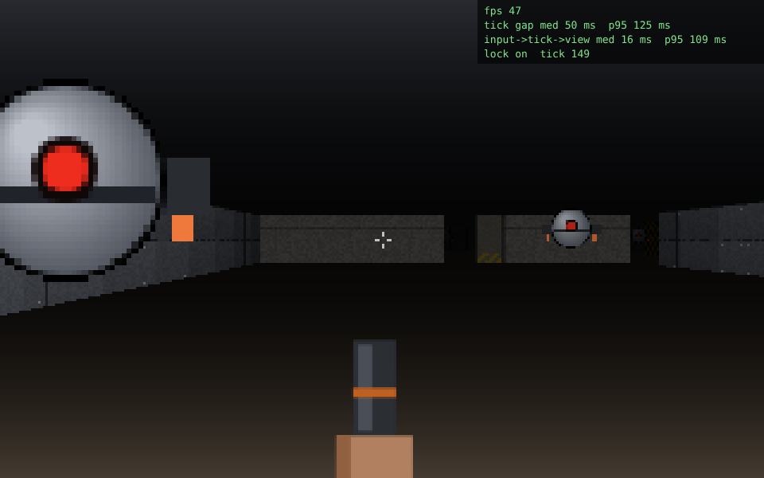

# Deep Station

**Status: M0 spike, code written; Power Fx not yet compiled in Studio.** An original first-person shooter in
the early-1990s style, built as a canvas Power App. All game logic runs in Power Fx on one Timer. A single PCF
code component, `RaycastView`, draws the 3D view, plays sound, and captures keyboard and mouse.



- [docs/01-game-spec.md](docs/01-game-spec.md): the specification, the Power Fx ↔ code component contract, and the build plan
- [docs/02-platform-decision.md](docs/02-platform-decision.md): why a code-component view (Option C)

Not affiliated with id Software, ZeniMax, or Bethesda. All maps, art, sound, and text are original; textures
and sprites are drawn procedurally in `pcf/RaycastView/src/`.

## Layout

```
pcf/                      the RaycastView code component (TypeScript, pcf-scripts)
  RaycastView/            ControlManifest.Input.xml, index.ts, src/ (renderer, input, audio, art)
  harness/                local test page: mock PCF host + JavaScript stand-in for the tick
tools/gen_app.py          emits canvas/Src/*.pa.yaml (generated; do not hand-edit)
tools/game_logic.py       the Power Fx: helper functions, tick, Frame formula, start
tools/levels.py           levels/*.txt -> map, lights, doors, things
tools/mcp-canvas.js       stdio client for the Canvas Authoring MCP server (from frogger/)
levels/m0-test.txt        the spike level: 28 x 16, 7 doors, 12 drones
```

## Install from a phone or any browser (no tools needed)

`release/DeepStation_unmanaged.zip` is built in the cloud by `./build.sh` and holds the RaycastView code
component and the app. Everything below works from a browser; only step 3 really wants a desktop-sized screen.

1. On GitHub, open `deep-station/release/DeepStation_unmanaged.zip` and choose **Download raw file**.
2. In [make.powerapps.com](https://make.powerapps.com) (on a phone, switch the browser to **Desktop site**),
   pick the **Workbench** environment, **Solutions > Import solution**, choose the zip, **Import**. It merges into
   the existing DeepStation solution and adds an app called **Deep Station M0**.
3. Open **Deep Station M0** for edit in Studio once, then **Save** and **Publish**. Microsoft requires this for an
   app packed from YAML: Studio validates the formulas on first open. If Studio reports formula errors, send
   them to the session; the generator gets fixed and a new zip is built.
4. Play it in the **Power Apps** Android app (landscape). Touch controls appear on the first touch: left thumb
   moves (push far to run), drag on the right side turns, **FIRE** and **USE** buttons bottom right.

## Build in the cloud or on Linux

```bash
cd deep-station
./build.sh                  # -> release/DeepStation_unmanaged.zip
ENEMY_SLOTS=8 ./build.sh    # fewer enemy slots
```

## Build and push (Windows, PowerShell 7)

Prerequisites: Node 18+, Python 3, `pac` 2.11+ signed in to Workbench, the .NET SDK for `dnx`, and the
DeepStation app open in Studio with coauthoring on.

```powershell
cd deep-station
.\build.ps1                                  # npm build of the component + regenerate canvas\Src
.\build.ps1 -PushPcf                         # import RaycastView into the DeepStation solution (wrk prefix)
```

Then, once, in Studio: **Insert > Get more components > Code**, pick **RaycastView**, and add it to the app
(delete the instance Studio drops on the screen; the YAML adds its own). Studio can't compile YAML that
references a code component the app doesn't know yet.

```powershell
.\build.ps1 -Push -AppId <app guid from the Studio URL> -LoginHint <your maker account>
.\build.ps1 -Push -AppId <guid> -EnemySlots 8      # rebuild with fewer slots
```

`-Push` compiles the YAML into the live session and prints App Checker errors.

## Spike checklist (M0, spec section 16)

Play in **Preview** or the published player with **DIAG** on, and note:

| Risk | Where to read it | Target |
|---|---|---|
| R1 tick rate | status bar `tps`, at SLOTS 4 / 8 / 12 | ≥ 15 |
| R2 frame arrival | overlay `tick gap med / p95` | ≤ 60 / 120 ms |
| R3 input round trip | overlay `input->tick->view` | ≤ 150 ms |
| R4 render | overlay `fps` | ≥ 50 desktop |
| R5 pointer lock | overlay `lock on / refused (drag mode)` | works, or drag turning is acceptable |
| R6 animation and listeners | the view moves at all in player, Studio, Teams | works in player |

Controls on a phone: see step 4 above. Keyboard: click the view, WASD move, mouse or ←/→ turn, Shift run, click or Ctrl fire, E or Space use,
1–2 weapon, Esc pause.

## Local test (Linux or Windows, no Power Apps needed)

```bash
cd pcf
npm ci && npm run build
node harness/build-harness.mjs      # bundles the harness, writes the level JSON
node harness/run-harness.mjs        # headless Chromium: walks, opens a door, fires, saves screenshots to harness/dist
node harness/run-touch.mjs          # Pixel 7 landscape emulation: stick, swipe turn, FIRE
```

The harness tests the view and the contract. It doesn't run Power Fx.
